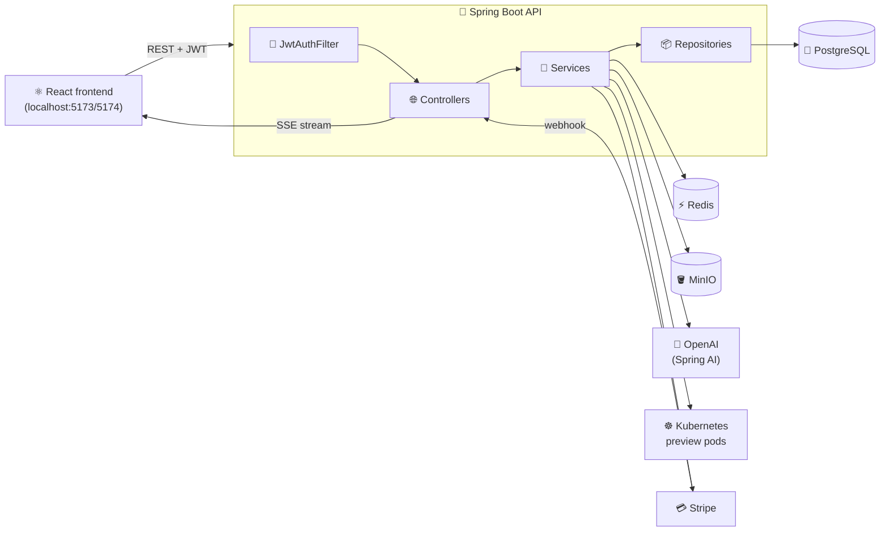
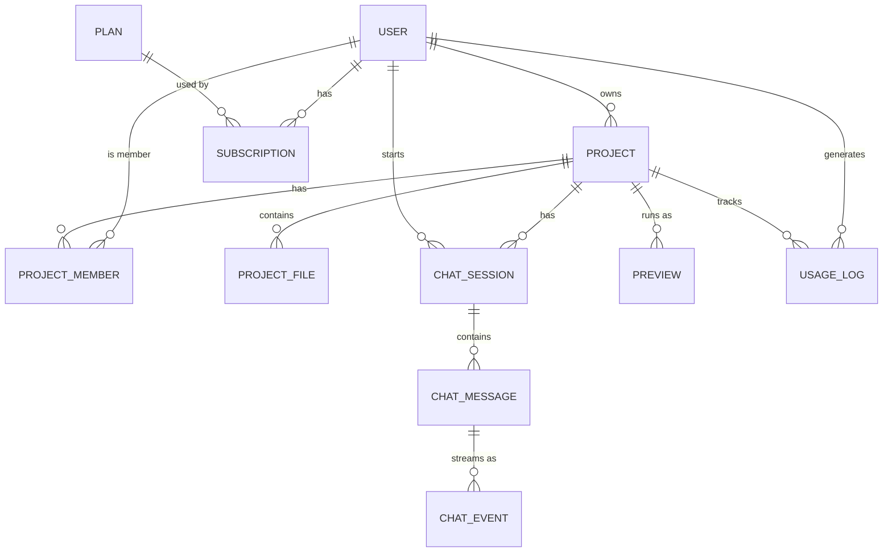

# 💜 Lovable Clone

> _"Describe it. Watch it get built."_ ✨
> An AI app builder, inspired by [Lovable](https://lovable.dev), that I'm building from scratch with **Spring Boot**. 🚀


---

## 👋 What is this?

Hey there! I'm **Monji**, and this is my take on a **Lovable-style AI app builder**. You chat with an AI, it writes the code for you, and you get a live preview of your app. 🪄

I'm building it one layer at a time, and this README grows as the project does. 🌱

---

## 📍 Where we're at right now

| Stage | Status |
| --- | --- |
| 🏗️ Project scaffolding (Spring Boot + Maven) | ✅ Done |
| 🧱 Domain model (entities + enums) | ✅ Done |
| 🗄️ JPA mappings (`@Entity`, relations, composite IDs, indexes) | ✅ Done |
| 📦 Repositories | ✅ Done |
| 🔁 DTOs (Java records) + MapStruct mappers | ✅ Done |
| 🌐 REST controllers | ✅ Wired up (auth, projects, members, files, chat, billing, usage) |
| 🔐 Auth & security (JWT filter, stateless config, project permissions) | 🚧 In progress |
| 🧠 Services & business logic | 🚧 In progress (project create/read working, the rest stubbed) |
| 🤖 AI / LLM integration (Spring AI + OpenAI, SSE streaming) | 🚧 Client + endpoint ready, generation logic pending |
| 💳 Stripe billing (checkout, customer portal, webhooks) | 🚧 Webhook handler ready, processor pending |
| 🪣 File storage (MinIO) | 🚧 Client configured |
| 🐳 Live previews (Kubernetes pods) | 🚧 Client configured, deploy endpoint added |
| ⚡ Redis | 🚧 Template configured |

> 💡 **Heads up:** the `feature/controllers` branch is mid-refactor. Service interfaces now read the current user from the JWT (via `AuthUtil`), but some implementations still take a `userId` parameter, and several controllers still use a hard-coded `userId = 1L`. See [Known gaps](#-known-gaps) before trying to build it.

---

## 🧰 Tech Stack

- ☕ **Java 21**
- 🍃 **Spring Boot 4.0.0**: Web MVC, Data JPA, Validation, Security, Data Redis
- 🔑 **JJWT 0.12.6** for signing and verifying access tokens
- 🤖 **Spring AI 2.0.0** (OpenAI starter) for chat and code generation
- 💳 **Stripe Java 31.1.0** for subscriptions and webhooks
- 🪣 **MinIO 8.6.0** as S3-compatible storage for project files
- ☸️ **Fabric8 Kubernetes Client 7.3.1** to spin up preview pods
- 🐘 **PostgreSQL** as the main database
- ⚡ **Redis** for fast key/value data
- 🗺️ **MapStruct 1.6.3** for entity ↔ DTO mapping
- 🌶️ **Lombok**, so I write less boilerplate
- 📦 **Maven** (wrapper included, nothing to install)

---

## 🏛️ Architecture



---

## 🌐 API Endpoints

All endpoints except `/api/auth/**` and the Stripe webhook need an `Authorization: Bearer <token>` header.

### 🔐 Auth: `/api/auth`

| Method | Path | What it does |
| --- | --- | --- |
| `POST` | `/api/auth/sign-up` | Create an account and get a token |
| `POST` | `/api/auth/login` | Log in and get a token |
| `GET` | `/api/auth/me` | Get the logged-in user's profile |

### 📁 Projects: `/api/projects`

| Method | Path | What it does |
| --- | --- | --- |
| `GET` | `/api/projects/get-my-projects` | List my projects |
| `GET` | `/api/projects/get-project?id={id}` | Get one project |
| `POST` | `/api/projects/create-project` | Create a project |
| `PATCH` | `/api/projects/update-project?id={id}` | Update a project |
| `DELETE` | `/api/projects/delete-project?id={id}` | Soft-delete a project |
| `POST` | `/api/projects/{id}/deploy` | Deploy a live preview |

### 🤝 Project Members: `/api/projects/{projectId}/members`

| Method | Path | What it does |
| --- | --- | --- |
| `GET` | `/members` | List members of a project |
| `POST` | `/members` | Invite a member |
| `PATCH` | `/members/update-member-role?memberId={id}` | Change a member's role |
| `DELETE` | `/members/delete-member?memberId={id}` | Remove a member |

### 📄 Files: `/api/projects/{projectId}/files`

| Method | Path | What it does |
| --- | --- | --- |
| `GET` | `/files/all` | Get the project's file tree |
| `GET` | `/files/{path}` | Get a file's content (the path can be nested, e.g. `src/App.tsx`) |

### 💬 Chat: `/api/chat`

| Method | Path | What it does |
| --- | --- | --- |
| `POST` | `/api/chat/stream` | Send a prompt and stream the AI's reply as **Server-Sent Events** |
| `GET` | `/api/chat/projects?projectId={id}` | Get a project's chat history |

### 💳 Billing

| Method | Path | What it does |
| --- | --- | --- |
| `GET` | `/api/plans` | List active plans |
| `GET` | `/api/my-subscription` | Get my current subscription |
| `POST` | `/api/payments/checkout` | Start a Stripe Checkout session |
| `POST` | `/api/payments/portal` | Open the Stripe customer portal |
| `POST` | `/webhooks/payment` | Stripe webhook (verified with `Stripe-Signature`) |

### 📊 Usage: `/api/usage`

| Method | Path | What it does |
| --- | --- | --- |
| `GET` | `/api/usage/today` | Today's tokens used and running previews, against my limits |
| `GET` | `/api/usage/limits` | Limits of my current plan |

---

## 🔐 Security

- **Stateless JWT auth.** `JwtAuthFilter` reads the `Bearer` token, verifies it with `AuthUtil`, and puts a `JwtUserPrincipal` (`userId`, `username`) into the security context.
- **Passwords** are hashed with `BCryptPasswordEncoder`.
- **Project-level permissions.** Each `ProjectRole` maps to a set of `ProjectPermission`s, and the `@security` bean (`SecurityExpressions`) checks them for use in `@PreAuthorize`:

| Role | `VIEW` | `EDIT` | `DELETE` | `VIEW_MEMBERS` | `MANAGE_MEMBERS` |
| --- | :---: | :---: | :---: | :---: | :---: |
| 👑 `OWNER` | ✅ | ✅ | ✅ | ✅ | ✅ |
| ✏️ `EDITOR` | ✅ | ✅ | ✅ | ✅ | ❌ |
| 👀 `VIEWER` | ✅ | ❌ | ❌ | ✅ | ❌ |

Available checks: `canViewProject`, `canEditProject`, `canDeleteProject`, `canViewMembers`, `canManageMembers`.

- **CORS** allows the React dev servers on `http://localhost:5173` and `http://localhost:5174`.
- **Errors** go through `GlobalExceptionHandler`, which returns an `ApiError`. Security exceptions are routed there too.

---

## 🗺️ Domain Model



### 🧩 Entities

| Entity | Table | What it does |
| --- | --- | --- |
| 👤 `User` | `users` | An account holder: username, password hash, name, avatar, Stripe customer ID. Implements Spring Security's `UserDetails`. Soft delete. |
| 📁 `Project` | `projects` | An app being built. Has an owner, can be public or private. Soft delete, with indexes on `updated_at` / `deleted_at`. |
| 🤝 `ProjectMember` | `project_member` | Who can collaborate on a project and in what role. Composite key `ProjectMemberId` (project + user). |
| 📄 `ProjectFile` | `project_file` | A file in a project. The path is stored here and the content lives in MinIO (`minioObjectKey`). Tracks who created and last updated it. |
| 💬 `ChatSession` | `chat_session` | A conversation between a user and the AI about a project. Composite key `ChatSessionId` (project + chat ID). Soft delete. |
| 🗨️ `ChatMessage` | `chat_message` | One message in a session: role, content, and tokens used. Holds an ordered list of `ChatEvent`s. |
| ⚡ `ChatEvent` | `chat_events` | One step of an AI reply (a thought, text, a file edit, or a tool log), ordered by `sequenceOrder`. |
| 👀 `Preview` | `preview` | A live running preview of a project. Tracked by K8s namespace, pod name, and URL. |
| 💎 `Plan` | `plan` | A pricing tier with limits on projects, daily tokens, and previews, plus an unlimited-AI flag. Linked to a Stripe price. |
| 🧾 `Subscription` | `subscription` | A user's subscription to a plan, synced with Stripe. |
| 📊 `UsageLog` | `usage_log` | A record of each AI action: tokens used, duration, and metadata. |

All IDs use their own PostgreSQL sequences (`user_seq`, `project_seq`, `chat_message_seq`, …).

### 🏷️ Enums

| Enum | Values |
| --- | --- |
| `ChatEventType` | `THOUGHT` · `MESSAGE` · `FILE_EDIT` · `TOOL_LOG` |
| `MessageRole` | `USER` · `ASSISTANT` · `SYSTEM` · `TOOL` |
| `PreviewStatus` | `CREATING` · `RUNNING` · `FAILED` · `TERMINATED` |
| `ProjectRole` | `OWNER` · `EDITOR` · `VIEWER` |
| `ProjectPermission` | `VIEW` · `EDIT` · `DELETE` · `VIEW_MEMBERS` · `MANAGE_MEMBERS` |
| `SubscriptionStatus` | `ACTIVE` · `TRIALING` · `CANCELED` · `PAST_DUE` · `INCOMPLETE` |

---

## 📂 Project Structure

```
lovable-clone/
├── 📄 pom.xml
├── 🔧 mvnw / mvnw.cmd
└── src/
    ├── main/
    │   ├── java/com/monji/projects/lovable_clone/
    │   │   ├── 🚀 LovableCloneApplication.java
    │   │   ├── ⚙️ config/       → AI, CORS, Kubernetes, Stripe, Redis, MinIO beans
    │   │   ├── 🌐 controller/   → REST endpoints
    │   │   ├── 📨 dto/          → request/response records (auth, chat, file, member, plan, project, subscription, usage, deploy)
    │   │   ├── 🧱 entity/       → JPA entities, grouped by domain
    │   │   ├── 🏷️ enums/        → roles, permissions, statuses
    │   │   ├── ❗ error/        → ApiError, custom exceptions, GlobalExceptionHandler
    │   │   ├── 🗺️ mapper/       → MapStruct mappers
    │   │   ├── 📦 repository/   → Spring Data JPA repositories
    │   │   ├── 🔐 security/     → JWT filter, AuthUtil, security config, permission checks
    │   │   └── 🧠 service/      → business logic (one package per service)
    │   └── resources/
    │       └── ⚙️ application.yaml
    └── test/
        └── 🧪 LovableCloneApplicationTests.java
```

---

## 🏃 Getting Started

### ✅ Prerequisites

- ☕ JDK 21+
- 🐘 PostgreSQL
- ⚡ Redis
- 🪣 MinIO (or any S3-compatible store)
- 🔑 An OpenAI API key
- 💳 A Stripe account (secret key + webhook secret)
- ☸️ Access to a Kubernetes cluster (only needed for previews)

### ⚙️ Configuration

`application.yaml` currently has only the datasource and JPA settings. The code also reads these properties, so add them (or set them as environment variables) before running:

```yaml
spring:
  datasource:
    url: jdbc:postgresql://localhost:9000/testDB
    username: testUser
    password: password
  data:
    redis:
      host: localhost
      port: 6379
  ai:
    openai:
      api-key: ${OPENAI_API_KEY}

jwt:
  secret-key: ${JWT_SECRET_KEY}          # at least 32 characters for HMAC-SHA256

stripe:
  api:
    secret: ${STRIPE_SECRET_KEY}
  webhook:
    secret: ${STRIPE_WEBHOOK_SECRET}

minio:
  url: http://localhost:9001
  access-key: ${MINIO_ACCESS_KEY}
  secret-key: ${MINIO_SECRET_KEY}
```

> ⚠️ `ddl-auto` is set to `create-drop`, so the schema is rebuilt on every start. That's handy while developing, but don't point it at data you care about.

### ▶️ Run it

```bash
# 🐧 macOS / Linux
./mvnw spring-boot:run

# 🪟 Windows
mvnw.cmd spring-boot:run
```

### 🧪 Test it

```bash
./mvnw test
```

---

## 🐞 Known gaps

These are still open on `feature/controllers`, so the branch won't compile until they're fixed:

- [ ] `AuthController`: `login` is mapped to `/sign-up` (should be `/login`).
- [ ] `WebSecurityConfig`: `jwtAuthFilter` isn't injected as a field, and `UsernamePasswordAuthenticaltionFilter` is misspelled. The webhook matcher `"*/webhooks/**"` should be `"/webhooks/**"`.
- [ ] `BillingController.createCheckoutResponse` passes an undefined `request` variable (should be `checkoutRequest`).
- [ ] Service interfaces and implementations disagree on the `userId` parameter (`ProjectService`, `FileService`, `SubscriptionService`), and `ProjectMemberController` calls its service without the `userId` it still expects. Some controllers also hard-code `userId = 1L` instead of using `AuthUtil.getCurrentUserId()`.
- [ ] `ProjectController.deleteProject` calls `softDelete(id)`, which isn't on `ProjectService` yet.
- [ ] No implementations yet for `ChatService`, `AiGenerationService`, `DeploymentService`, `PaymentProcessor`, or `ProjectFileService`.
- [ ] Stub methods returning `null` in the auth, user, usage, subscription, member, and file services.
- [ ] `@PreAuthorize` checks using the `@security` bean aren't applied to controllers yet.

---

## 🛣️ Roadmap

- [x] 🏗️ Bootstrap the Spring Boot project
- [x] 🧱 Sketch the domain entities & enums
- [x] 🗄️ Add JPA annotations + PostgreSQL config
- [x] 📦 Repositories, DTOs & MapStruct mappers
- [x] 🌐 REST controllers for projects, members, files, chat, billing & usage
- [ ] 🔐 Finish JWT auth (sign-up/login, `@PreAuthorize` on endpoints)
- [ ] 🧠 Fill in the remaining service implementations
- [ ] 🤖 AI code generation with tool calling, streamed over SSE
- [ ] 🪣 Read and write project files in MinIO
- [ ] ☸️ Kubernetes-powered live previews
- [ ] 💳 Stripe checkout, portal & webhook processing
- [ ] 📊 Usage tracking and plan limits
- [ ] 🧪 Tests

---

## 🙌 Credits

Built with ❤️, ☕, and a lot of 🐛 squashing by **Monji** as part of the _Spring Boot 0 → 100_ course journey.

⭐ If you like where this is going, drop a star! ⭐
