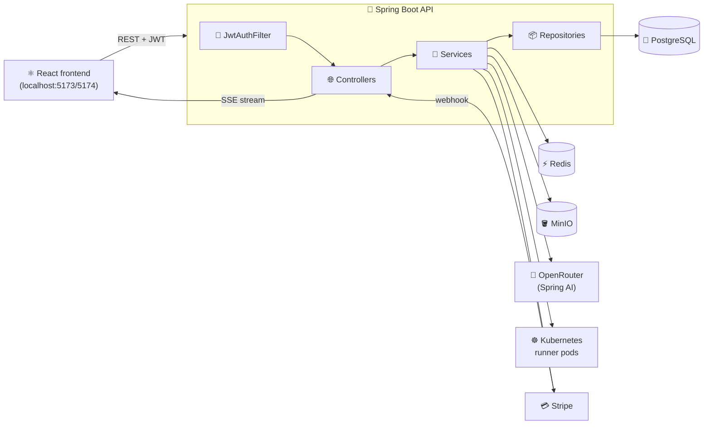
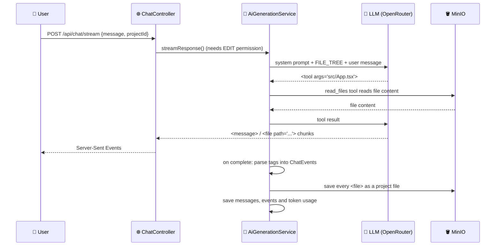
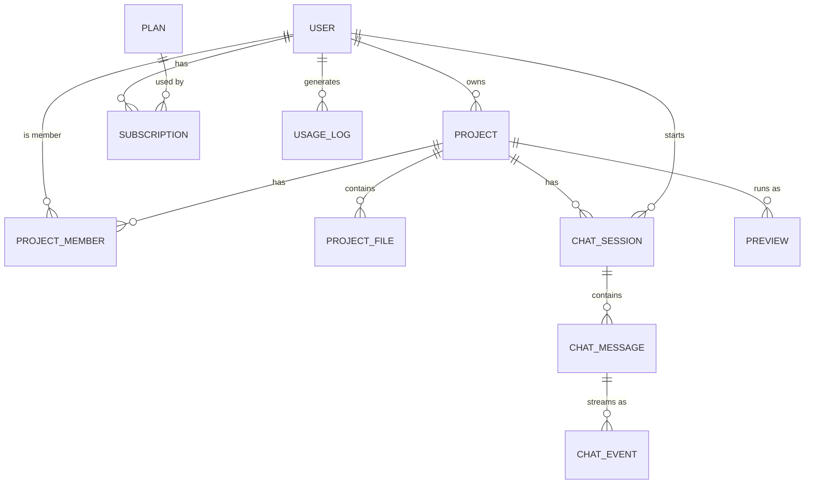

# 💜 Lovable Clone

> _"Describe it. Watch it get built."_ ✨
> An AI app builder, inspired by [Lovable](https://lovable.dev), that I'm building from scratch with **Spring Boot**. 🚀


---

## 👋 What is this?

Hey there! I'm **Monji**, and this is my take on a **Lovable-style AI app builder**. You chat with an AI, it writes the code for you, and you get a live preview of your app. 🪄

I'm building it one layer at a time, and this README grows as the project does. 🌱

---

## 📍 Where we're at right now

| Stage | Status |
| --- | --- |
| 🏗️ Project scaffolding (Spring Boot + Maven) | ✅ Done |
| 🧱 Domain model (entities + enums) | ✅ Done |
| 🗄️ JPA mappings (`@Entity`, relations, composite IDs, indexes) | ✅ Done |
| 📦 Repositories, DTOs (records) & MapStruct mappers | ✅ Done |
| 🌐 REST controllers | ✅ Done |
| 🔐 Auth & security (sign-up/login, JWT filter, `@PreAuthorize` project permissions) | ✅ Done |
| 📁 Projects & members (create from template, update, soft delete, invite, roles) | ✅ Done |
| 🤖 AI code generation (Spring AI + OpenRouter, tool calling, SSE streaming) | ✅ Working |
| 🪣 File storage (MinIO: starter template, save AI-generated files) | ✅ Working |
| 💳 Stripe billing (checkout, customer portal, webhook processing) | ✅ Working |
| 🐳 Live previews (Kubernetes runner pool + Redis routes) | ✅ Deploy flow implemented |
| 📊 Usage tracking & plan limits | 🚧 Tokens recorded, limit check and usage endpoints pending |
| 📄 File tree / file content API | 🚧 Endpoint wired to a stub service |
| 🧪 Tests | ⏳ Planned |

> 💡 See [Known gaps](#-known-gaps) for what's still stubbed out.

---

## 🧰 Tech Stack

- ☕ **Java 21**
- 🍃 **Spring Boot 4.0.0**: Web MVC, Data JPA, Validation, Security, Data Redis
- 🔑 **JJWT 0.12.6** for signing and verifying access tokens
- 🤖 **Spring AI 2.0.0** (OpenAI starter) pointed at **OpenRouter**, so any OpenRouter model can be used
- 💳 **Stripe Java 31.1.0** for subscriptions and webhooks
- 🪣 **MinIO 8.6.0** as S3-compatible storage for project files
- ☸️ **Fabric8 Kubernetes Client 7.3.1** to claim and drive preview pods
- 🐘 **PostgreSQL 16** as the main database (via Docker Compose)
- ⚡ **Redis** for preview routing (`route:<domain>` → pod IP)
- 🗺️ **MapStruct 1.6.3** for entity ↔ DTO mapping
- 🌶️ **Lombok**, so I write less boilerplate
- 📦 **Maven** (wrapper included, nothing to install)

---

## 🏛️ Architecture



---

## 🤖 How AI generation works



- **System prompt** (`PromptUtils`): an "elite React architect" producing React 18 + TypeScript + Vite + Tailwind CSS 4 + daisyUI v5 apps, answering only in `<message>`, `<tool>` and `<file>` tags.
- **`FileTreeContextAdvisor`** adds the project's current file tree to the prompt, so the model knows which files exist.
- **`CodeGenerationTools.read_files`** is a Spring AI `@Tool` that lets the model read files from MinIO before editing them.
- **`LlmResponseParser`** turns the finished response into ordered `ChatEvent`s (`MESSAGE`, `FILE_EDIT`, `TOOL_LOG`), plus a leading `THOUGHT` event ("Thought for Ns").
- **Token usage** from the response metadata is added to the user's daily `UsageLog`.
- **Model choice** comes from the `CHAT_MODEL_IN_USE` environment variable (see [Configuration](#️-configuration)).

---

## 🌐 API Endpoints

All endpoints except `/api/auth/**` and `/webhooks/**` need an `Authorization: Bearer <token>` header.
A ready-made Postman collection lives in [`postman/Lovable-Clone.postman_collection.json`](postman/Lovable-Clone.postman_collection.json). 📮

### 🔐 Auth: `/api/auth`

| Method | Path | What it does |
| --- | --- | --- |
| `POST` | `/api/auth/sign-up` | Create an account and get a token |
| `POST` | `/api/auth/login` | Log in and get a token |
| `GET` | `/api/auth/me` | Get the logged-in user's profile |

### 📁 Projects: `/api/projects`

| Method | Path | Permission | What it does |
| --- | --- | --- | --- |
| `GET` | `/api/projects/get-my-projects` | (any member) | List projects I own or am a member of, with my role |
| `GET` | `/api/projects/get-project?id={id}` | `VIEW` | Get one project |
| `POST` | `/api/projects/create-project` | (plan limit) | Create a project, make me `OWNER`, and copy the starter template into it |
| `PATCH` | `/api/projects/update-project?id={id}` | `EDIT` | Rename a project |
| `DELETE` | `/api/projects/delete-project?id={id}` | `DELETE` | Soft-delete a project |
| `POST` | `/api/projects/{id}/deploy` | | Deploy a live preview |

### 🤝 Project Members: `/api/projects/{projectId}/members`

| Method | Path | Permission | What it does |
| --- | --- | --- | --- |
| `GET` | `/members` | `VIEW_MEMBERS` | List members of a project |
| `POST` | `/members` | `MANAGE_MEMBERS` | Invite a user by username with a role |
| `PATCH` | `/members/update-member-role?memberId={id}` | `MANAGE_MEMBERS` | Change a member's role |
| `DELETE` | `/members/delete-member?memberId={id}` | `MANAGE_MEMBERS` | Remove a member |

### 📄 Files: `/api/projects/{projectId}/files`

| Method | Path | What it does |
| --- | --- | --- |
| `GET` | `/files/all` | Get the project's file tree (🚧 stub) |
| `GET` | `/files/{path}` | Get a file's content; the path can be nested, e.g. `src/App.tsx` (🚧 stub) |

### 💬 Chat: `/api/chat`

| Method | Path | Permission | What it does |
| --- | --- | --- | --- |
| `POST` | `/api/chat/stream` | `EDIT` | Send a prompt and stream the AI's reply as **Server-Sent Events** |
| `GET` | `/api/chat/projects?projectId={id}` | | Get my chat history for a project |

### 💳 Billing

| Method | Path | What it does |
| --- | --- | --- |
| `GET` | `/api/plans` | List active plans (🚧 returns an empty list for now) |
| `GET` | `/api/my-subscription` | Get my current subscription |
| `POST` | `/api/payments/checkout` | Start a Stripe Checkout session for a plan |
| `POST` | `/api/payments/portal` | Open the Stripe customer portal |
| `POST` | `/webhooks/payment` | Stripe webhook (verified with `Stripe-Signature`) |

Handled webhook events:

| Stripe event | What happens |
| --- | --- |
| `checkout.session.completed` | Saves the Stripe customer ID on the user and creates the subscription |
| `customer.subscription.updated` | Syncs status, billing period, cancel-at-period-end and plan |
| `customer.subscription.deleted` | Marks the subscription `CANCELED` |
| `invoice.paid` | Renews the billing period and moves `PAST_DUE` / `INCOMPLETE` back to `ACTIVE` |
| `invoice.payment_failed` | Marks the subscription `PAST_DUE` |

### 📊 Usage: `/api/usage`

| Method | Path | What it does |
| --- | --- | --- |
| `GET` | `/api/usage/today` | Today's usage against my limits (🚧 stub) |
| `GET` | `/api/usage/limits` | Limits of my current plan (🚧 stub) |

---

## 🔐 Security

- **Stateless JWT auth.** `JwtAuthFilter` reads the `Bearer` token, verifies it with `AuthUtil`, and puts a `JwtUserPrincipal` (`userId`, `username`) into the security context. Tokens expire after 100 minutes.
- **Sign-up / login.** `AuthService` checks for duplicate usernames, hashes passwords with `BCryptPasswordEncoder`, and logs in through Spring's `AuthenticationManager`.
- **Public routes:** `/api/auth/**` and `/webhooks/**`. Async and error dispatches are also permitted so SSE streams and error responses work.
- **Project-level permissions.** Each `ProjectRole` maps to a set of `ProjectPermission`s. The `@security` bean (`SecurityExpressions`) checks them, and services use it in `@PreAuthorize`:

| Role | `VIEW` | `EDIT` | `DELETE` | `VIEW_MEMBERS` | `MANAGE_MEMBERS` |
| --- | :---: | :---: | :---: | :---: | :---: |
| 👑 `OWNER` | ✅ | ✅ | ✅ | ✅ | ✅ |
| ✏️ `EDITOR` | ✅ | ✅ | ✅ | ✅ | ❌ |
| 👀 `VIEWER` | ✅ | ❌ | ❌ | ✅ | ❌ |

- **CORS** allows the React dev servers on `http://localhost:5173` and `http://localhost:5174`.
- **Errors** go through `GlobalExceptionHandler`, which returns an `ApiError`. Access-denied errors are routed there too.
- **Secrets** are never stored in the repo. `application.yaml` only references environment variables (see below).

---

## 🐳 Live previews

`POST /api/projects/{id}/deploy` uses a **pool of pre-started runner pods** in the `monji-apps` namespace:

1. If a pod labelled `project_id=<id>, status=busy` is already running, reuse it.
2. Otherwise claim a pod labelled `status=idle`, and relabel it `busy` with the project ID.
3. In the pod's `syncer` container, mirror `myminio/projects/<id>/` into `/app/` with `mc mirror`, then keep a `--watch` mirror running so AI edits show up live.
4. In the `runner` container, run `npm install` and start `npm run dev` on port `5173`.
5. Store `route:project-<id>.app.domain.com` → `<podIP>:5173` in Redis for 6 hours, for a reverse proxy on port `8090` to route by.

If anything fails, the pod is deleted and the error is returned.

---

## 🗺️ Domain Model



### 🧩 Entities

| Entity | Table | What it does |
| --- | --- | --- |
| 👤 `User` | `users` | An account holder: username, password hash, name, avatar, Stripe customer ID. Implements Spring Security's `UserDetails`. Soft delete. |
| 📁 `Project` | `projects` | An app being built. Has an owner, can be public or private. Soft delete, with indexes on `updated_at` / `deleted_at`. |
| 🤝 `ProjectMember` | `project_member` | Who can collaborate on a project and in what role. Composite key `ProjectMemberId` (project + user). |
| 📄 `ProjectFile` | `project_file` | A file in a project. The path is stored here and the content lives in MinIO (`minioObjectKey` = `<projectId>/<path>`). |
| 💬 `ChatSession` | `chat_session` | One conversation per user per project. Composite key `ChatSessionId` (project + user). Soft delete. |
| 🗨️ `ChatMessage` | `chat_message` | One message in a session: role, content, and tokens used. Holds an ordered list of `ChatEvent`s. |
| ⚡ `ChatEvent` | `chat_events` | One step of an AI reply (a thought, text, a file edit, or a tool log), ordered by `sequenceOrder`. |
| 👀 `Preview` | `preview` | A live running preview of a project. Tracked by K8s namespace, pod name, and URL. |
| 💎 `Plan` | `plan` | A pricing tier with limits on projects, daily tokens, and previews, plus an unlimited-AI flag. Linked to a Stripe price. |
| 🧾 `Subscription` | `subscription` | A user's subscription to a plan, synced with Stripe (subscription ID, status, billing period, cancel-at-period-end). |
| 📊 `UsageLog` | `usage_log` | Tokens used by a user on a given day. |

All IDs use their own PostgreSQL sequences (`user_seq`, `project_seq`, `chat_message_seq`, `usage_log_seq`, …).

### 🏷️ Enums

| Enum | Values |
| --- | --- |
| `ChatEventType` | `THOUGHT` · `MESSAGE` · `FILE_EDIT` · `TOOL_LOG` |
| `MessageRole` | `USER` · `ASSISTANT` · `SYSTEM` · `TOOL` |
| `PreviewStatus` | `CREATING` · `RUNNING` · `FAILED` · `TERMINATED` |
| `ProjectRole` | `OWNER` · `EDITOR` · `VIEWER` |
| `ProjectPermission` | `VIEW` · `EDIT` · `DELETE` · `VIEW_MEMBERS` · `MANAGE_MEMBERS` |
| `SubscriptionStatus` | `ACTIVE` · `TRIALING` · `CANCELED` · `PAST_DUE` · `INCOMPLETE` |

---

## 📂 Project Structure

```
lovable-clone/
├── 📄 pom.xml
├── 🐳 compose.yaml          → PostgreSQL 16 for local dev
├── 📮 postman/              → Postman collection for every endpoint
├── 🔧 mvnw / mvnw.cmd
└── src/
    ├── main/
    │   ├── java/com/monji/projects/lovable_clone/
    │   │   ├── 🚀 LovableCloneApplication.java
    │   │   ├── ⚙️ config/       → AI, CORS, Kubernetes, Stripe, Redis, MinIO beans
    │   │   ├── 🌐 controller/   → REST endpoints
    │   │   ├── 📨 dto/          → request/response records (auth, chat, deploy, file, member, plan, project, subscription, usage)
    │   │   ├── 🧱 entity/       → JPA entities, grouped by domain
    │   │   ├── 🏷️ enums/        → roles, permissions, statuses
    │   │   ├── ❗ error/        → ApiError, custom exceptions, GlobalExceptionHandler
    │   │   ├── 🤖 llm/          → system prompt, response parser, advisors, tools
    │   │   ├── 🗺️ mapper/       → MapStruct mappers
    │   │   ├── 📦 repository/   → Spring Data JPA repositories
    │   │   ├── 🔐 security/     → JWT filter, AuthUtil, security config, permission checks
    │   │   └── 🧠 service/      → business logic (one package per service)
    │   └── resources/
    │       └── ⚙️ application.yaml   → reads secrets from environment variables
    └── test/
        └── 🧪 LovableCloneApplicationTests.java
```

---

## 🏃 Getting Started

### ✅ Prerequisites

- ☕ JDK 21+
- 🐳 Docker (for PostgreSQL via `compose.yaml`)
- ⚡ Redis on `localhost:6379`
- 🪣 MinIO on `localhost:9000` with two buckets:
  - `starter-projects`: the starter React app, stored under a `starter-projects/` prefix. It's copied into every new project.
  - `projects`: where each project's files live, under `<projectId>/`.
- 🔑 An [OpenRouter](https://openrouter.ai) API key
- 💳 A Stripe account (secret key + webhook secret, plus a Stripe price ID on each `Plan` row)
- ☸️ A Kubernetes cluster with idle runner pods in the `monji-apps` namespace (only needed for previews)

### 🐘 Start the infrastructure

```bash
# PostgreSQL 16 on localhost:9010 (db: pgvector-test, user: user)
docker compose up -d

# Redis and MinIO (if you don't already run them)
docker run -d --name redis -p 6379:6379 redis:7
docker run -d --name minio -p 9000:9000 -p 9001:9001 \
  -e MINIO_ROOT_USER=minioadmin -e MINIO_ROOT_PASSWORD=<your-password> \
  minio/minio server /data --console-address ":9001"
```

### ⚙️ Configuration

`application.yaml` doesn't contain any secrets. It reads everything from environment variables:

| Variable | Required | Default | Used for |
| --- | :---: | --- | --- |
| `DB_URL` | | `jdbc:postgresql://localhost:9010/pgvector-test` | PostgreSQL JDBC URL |
| `DB_USERNAME` | ✅ | | PostgreSQL user |
| `DB_PASSWORD` | ✅ | | PostgreSQL password |
| `REDIS_HOST` | | `localhost` | Redis host |
| `REDIS_PORT` | | `6379` | Redis port |
| `OPENROUTER_API_KEY` | ✅ | | OpenRouter API key |
| `OPENROUTER_BASE_URL` | | `https://openrouter.ai/api` | OpenAI-compatible base URL |
| `CHAT_MODEL_IN_USE` | | `nvidia/nemotron-3.5-lightning:free` | The model the app uses |
| `CHAT_MODEL_1`, `CHAT_MODEL_2`, … | | | Alternative models to swap into `CHAT_MODEL_IN_USE` (not read by the app) |
| `JWT_SECRET_KEY` | ✅ | | HMAC-SHA key for JWTs (at least 32 characters) |
| `STRIPE_API_SECRET` | ✅ | | Stripe secret key |
| `STRIPE_WEBHOOK_SECRET` | ✅ | | Stripe webhook signing secret |
| `CLIENT_URL` | | `http://localhost:8080` | Frontend URL for Stripe success/cancel/return redirects |
| `MINIO_URL` | | `http://localhost:9000` | MinIO endpoint |
| `MINIO_ACCESS_KEY` | ✅ | | MinIO access key |
| `MINIO_SECRET_KEY` | ✅ | | MinIO secret key |
| `MINIO_PROJECT_BUCKET` | | `projects` | Bucket for project files |

**🪟 Windows, terminal:** create a `setenv.bat` in the project root. It's gitignored, so your keys stay local.

```bat
@echo off
set DB_USERNAME=user
set DB_PASSWORD=<db-password>
set OPENROUTER_API_KEY=<openrouter-key>
set CHAT_MODEL_1=x-ai/grok-code-fast-1
set CHAT_MODEL_2=google/gemini-3-flash-preview
set CHAT_MODEL_IN_USE=nvidia/nemotron-3.5-lightning:free
set JWT_SECRET_KEY=<at-least-32-characters>
set STRIPE_API_SECRET=<sk_test_...>
set STRIPE_WEBHOOK_SECRET=<whsec_...>
set MINIO_ACCESS_KEY=<minio-user>
set MINIO_SECRET_KEY=<minio-password>
```

**💡 IntelliJ:** add the same variables under _Run → Edit Configurations → Environment variables_.

**🐧 macOS / Linux:** `export` the same variables, or put them in a gitignored `setenv.sh` and `source` it.

> ⚠️ `ddl-auto` is set to `update`, so Hibernate creates and alters tables automatically. Handy for development, but use migrations before pointing it at real data.

### ▶️ Run it

```bash
# 🪟 Windows
call setenv.bat && mvnw.cmd spring-boot:run

# 🐧 macOS / Linux
source setenv.sh && ./mvnw spring-boot:run
```

The API starts on `http://localhost:8080`.

### 💳 Test Stripe webhooks locally

```bash
stripe listen --forward-to localhost:8080/webhooks/payment
```

Use the `whsec_...` it prints as `STRIPE_WEBHOOK_SECRET`.

### 🧪 Test it

```bash
./mvnw test
```

---

## 🐞 Known gaps

- [ ] `FileController` uses the stub `FileService`, so `/files/all` returns an empty list and `/files/{path}` returns nothing. The working logic is already in `ProjectFileService`.
- [ ] `PlanService.getAllActivePlans()` returns an empty list.
- [ ] `UsageService.getTodayUsageOfUser` and `getCurrentSubscriptionLimitsOfUser` return `null`, and `UsageController` still passes a hard-coded `userId = 1L`.
- [ ] The daily token limit check (`usageService.checkDailyTokensUsage()`) is commented out in `AiGenerationServiceImpl`.
- [ ] The saved assistant `ChatMessage` content is a placeholder ("Assistant Message here..."); the real content lives in its `ChatEvent`s.
- [ ] `StripePaymentProcesser.createCheckoutSessionUrl` passes the username as the Stripe customer when the user has no Stripe customer ID yet. Stripe expects a customer ID there, so first-time checkout should set the customer email instead.
- [ ] `/api/projects/{id}/deploy` has no `@PreAuthorize` check, and the preview domain (`*.app.domain.com`) and namespace are hard-coded.
- [ ] The free tier allows 100 projects (`FREE_TIER_PROJECTS_ALLOWED`), which is a placeholder value.
- [ ] No tests beyond the context-load test.

---

## 🛣️ Roadmap

- [x] 🏗️ Bootstrap the Spring Boot project
- [x] 🧱 Sketch the domain entities & enums
- [x] 🗄️ Add JPA annotations + PostgreSQL config
- [x] 📦 Repositories, DTOs & MapStruct mappers
- [x] 🌐 REST controllers for projects, members, files, chat, billing & usage
- [x] 🔐 JWT auth with sign-up/login and `@PreAuthorize` project permissions
- [x] 🤖 AI code generation with tool calling, streamed over SSE
- [x] 🪣 Starter template + AI-generated files stored in MinIO
- [x] 💳 Stripe checkout, portal & webhook processing
- [x] ☸️ Kubernetes-powered live previews (runner pool)
- [x] 🔒 Secrets moved out of the repo into environment variables
- [ ] 📄 File tree & file content endpoints backed by MinIO
- [ ] 📊 Usage endpoints and daily token limits
- [ ] 💎 Plan listing
- [ ] 🧪 Tests

---

## 🙌 Credits

Built with ❤️, ☕, and a lot of 🐛 squashing by **Monji** as part of the _Spring Boot 0 → 100_ course journey.

⭐ If you like where this is going, drop a star! ⭐
